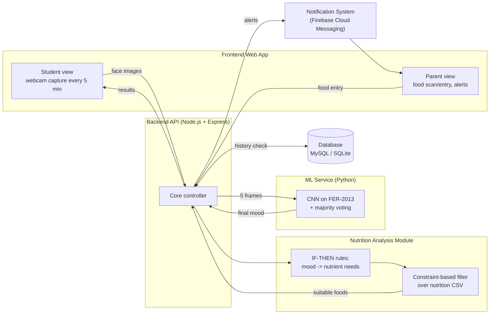

# EduEats — Architecture

Reference diagram of the system as described in the proposal report. Nothing here is
implemented yet — this is the map to build against.

## Data flow (5 stages)

1. **Input** — student attends class, webcam captures a frame every 5 min; parent logs food.
2. **Mood processing** — last 5 frames go through the CNN, majority vote picks final mood.
3. **Decision & logic** — mood mapped to nutrient requirements via IF-THEN rules.
4. **Nutrition & history integration** — nutrient constraints filter the nutrition CSV;
   database history avoids repeating the same food.
5. **Output & feedback** — results shown in the web app and pushed to the parent's phone via
   FCM; everything gets logged to the database.
